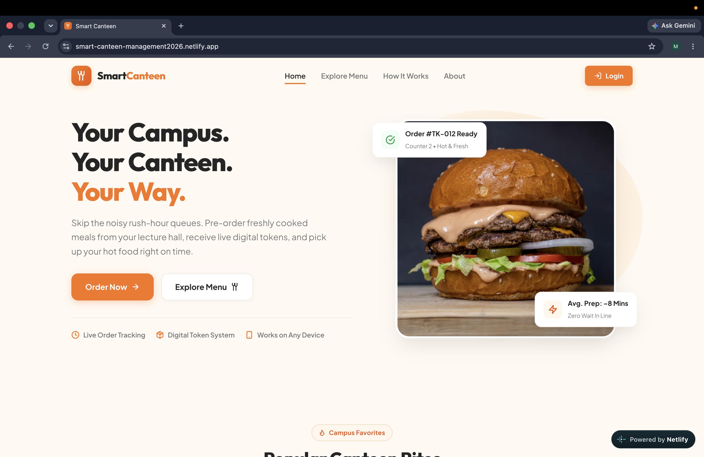
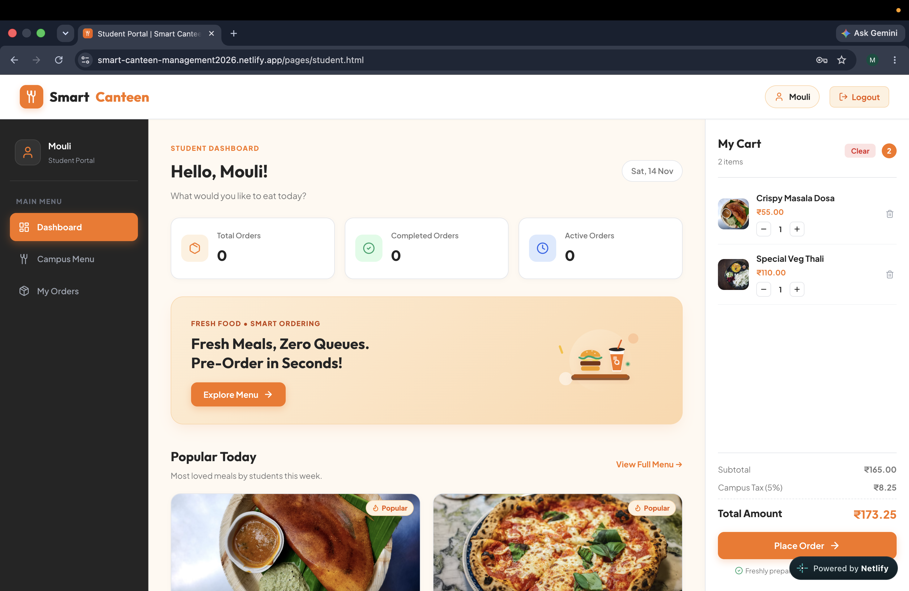
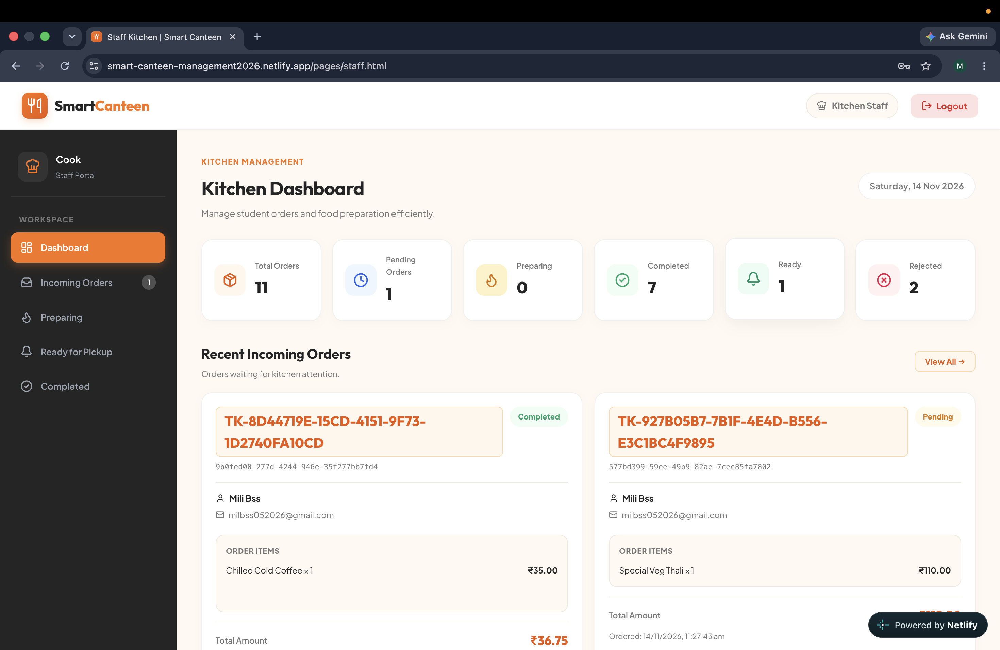
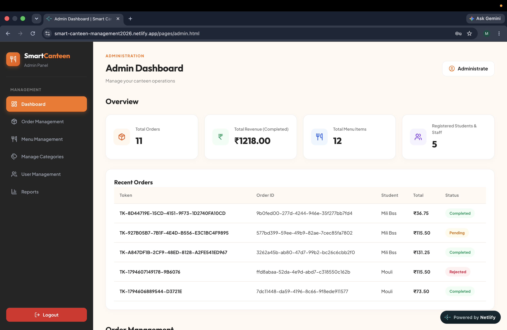

# Smart Canteen Management System

A modern, responsive web application designed for campus dining. Smart Canteen replaces chaotic cafeteria lines with digital food ordering, instant token generation, real-time preparation tracking for students, streamlined order management for kitchen staff, and menu and revenue analytics for administrators.

---

## Badges


---

## Features

### 1. Public Landing Page (`index.html`)
- **Modern Food-Tech Presentation**: Hero section with value proposition, active user statistics, and quick portal links.
- **Interactive Menu Showcase**: Displays real-time popular food items with dynamic dietary badges (Veg / Non-Veg) and prices.
- **Workflow Overview**: Step-by-step visual explanation of the digital dining process (Browse Menu &rarr; Order Online &rarr; Pick Up Food).
- **Responsive Architecture**: Fully responsive header, mobile navigation drawer, and sticky navigation bar.

### 2. Authentication & Access Control (`pages/login.html`, `js/auth.js`)
- **Role-Based Authentication**: Dedicated authentication flows for three user roles: **Student**, **Canteen Staff**, and **Administrator**.
- **Supabase Auth Integration**: Secure account creation and password authentication powered by Supabase Auth.
- **Student Self-Registration**: Direct registration for students with full name, email, and password validation.
- **Strict Role Guard (`enforceRole`)**: Prevents unauthorized portal access; automatically redirects users to their designated dashboards if accessed without active credentials or if attempting to access another role's dashboard.
- **Session Persistence**: Session stored in client storage (`smartCanteenCurrentUser`) with automatic `pageshow` back-button navigation validation.
- **Demo Credentials Display**: Context-aware demo credentials shown for Staff and Admin roles for swift demonstration, while keeping the Student interface clean for personal registrations.

### 3. Student Ordering Portal (`pages/student.html`, `js/student.js`)
- **Personalized Header**: Dynamic greeting with student name and current date.
- **Menu Search & Category Filtering**: Concurrently filter items by category pills and real-time text search across item names and descriptions.
- **Cart Management with Persistence**: Add/remove items and adjust quantities (constrained between 1 and 10); per-student cart survives page reloads via browser `localStorage` (`smartCanteenCart_<studentId>`).
- **Live Tax & Total Calculation**: Automatic 5% campus tax calculation alongside subtotal and grand total computation.
- **Digital Token Generation**: Instant generation of unique, sequential pickup tokens (e.g., `TK-001`, `TK-002`) upon order submission.
- **Supabase Cloud Sync**: Direct insertion of order master records into `orders` and line items into `order_items`.
- **Live Order Tracker**: Visual multi-step progress stepper (**Pending** &rarr; **Preparing** &rarr; **Ready** &rarr; **Completed**) with real-time Supabase status listening and periodic polling.

### 4. Kitchen Staff Portal (`pages/staff.html`, `js/staff.js`)
- **Real-Time Kanban-Style Order Sections**: Dedicated order lanes for Incoming (Pending), In Preparation, Ready for Pickup, and Completed orders.
- **Status Advancement Workflow**:
  - `Pending` &rarr; `Preparing` (Accept order)
  - `Preparing` &rarr; `Ready` (Notify student for pickup)
  - `Ready` &rarr; `Completed` (Confirm collection at counter)
  - `Pending` &rarr; `Rejected` (Reject with confirmation modal)
- **Detailed Order Cards**: Shows order token, student name, email, ordered items list, item quantities, total amount, and order timestamp.
- **Automatic Polling & Refresh**: Periodically fetches fresh database state from Supabase every 3 seconds to keep kitchen display synchronized.

### 5. Administrator Dashboard (`pages/admin.html`, `js/admin.js`)
- **Operational Metrics & KPIs**: Instant cards showing Total Orders, Total Revenue (strictly calculated from `Completed` orders), Total Menu Items, and Registered Users.
- **Menu Item Management (CRUD)**: Modal form to add new food items, edit pricing/descriptions, toggle stock availability, and delete menu items directly in the database.
- **Category Management**: Create new categories, rename existing categories, and safely delete categories with validation preventing deletion of categories in active use.
- **User Management**: View all registered student and staff profiles retrieved directly from the Supabase `profiles` table.
- **Reports & Analytics**:
  - Order status percentage distribution with color-coded progress bars.
  - Top-selling food items breakdown showing units sold and revenue generated from completed orders.
- **Demo Reset Functionality**: Ability to reset local menu states back to default configuration.

---

## Tech Stack

| Component | Technology | Description |
|---|---|---|
| **Frontend Markup** | HTML5 | Semantic markup across all dashboard and portal pages |
| **Frontend Styling** | CSS3 | Custom CSS variables, Flexbox, CSS Grid, media queries (Warm Minimal Food-Tech theme) |
| **Frontend Logic** | Vanilla JavaScript (ES6+) | Modern asynchronous JavaScript (Promises, `async`/`await`), DOM manipulation, Event delegation |
| **Backend as a Service** | Supabase | PostgreSQL Database, User Authentication, PostgREST API, Realtime Subscriptions |
| **Database** | PostgreSQL | Relational database hosting `profiles`, `menu_items`, `categories`, `orders`, `order_items` |
| **Icons** | Lucide Icons | Outline icons loaded via unpkg CDN (`lucide@latest`) |
| **Typography** | Google Fonts | Plus Jakarta Sans & Outfit font families |
| **Client Persistence** | LocalStorage API | Local session state, per-student cart persistence, and offline fallback |

> **Architecture Note:** No external build tools (Webpack, Vite), node runtimes, or frontend frameworks (React, Next.js, Vue) are required. The project runs directly in any modern web browser or lightweight HTTP server.

---

## Project Structure

```text
SmartCanteen/
├── assets/                               # Static images, vectors, and brand icons
│   └── images/                           # Image assets directory
│       ├── favicon.ico                   # Multi-resolution favicon icon for legacy/standard browsers
│       ├── favicon.png                   # High-resolution PNG favicon (64x64)
│       ├── favicon.svg                   # Crisp, scalable vector SVG brand favicon
│       ├── favicon-32x32.png             # Standard 32x32 PNG favicon
│       ├── food/                         # Food photography and fallbacks
│       │   └── fallback.svg              # Fallback vector image for items missing photos
│       └── illustrations/                # Custom vector illustrations for empty and portal states
│           ├── empty-cart.svg            # Graphic shown when student cart is empty
│           ├── empty-dashboard.svg       # Graphic for empty dashboard states
│           ├── kitchen.svg               # Kitchen illustration used in staff portal
│           ├── login.svg                 # Authentication portal brand graphic
│           ├── no-orders.svg             # Graphic shown when no orders are found
│           ├── step-browse.svg           # Landing page illustration: Browse Menu
│           ├── step-order.svg            # Landing page illustration: Order Online
│           ├── step-pickup.svg           # Landing page illustration: Pick Up Food
│           └── student-welcome.svg       # Student welcome banner graphic
├── css/                                  # Stylesheets
│   ├── admin.css                         # Layout and styling for Administrator operations portal
│   ├── home.css                          # Scoped styling for the modern landing page
│   ├── staff.css                         # Kitchen Kanban board styling for staff portal
│   ├── student.css                       # Student portal catalog, cart drawer, and order tracking styling
│   └── style.css                         # Shared global design system, CSS variables, utilities, and resets
├── js/                                   # Application logic scripts
│   ├── admin.js                          # Admin dashboard logic: Supabase order/user fetching, menu CRUD, analytics
│   ├── auth.js                           # Authentication module: Supabase Auth, login/register, role guards
│   ├── data.js                           # Data access layer: Supabase menu/category sync, fallback defaults, formatting
│   ├── home.js                           # Landing page interactive logic: dynamic navigation, menu showcase
│   ├── staff.js                          # Staff portal logic: order queue management, kitchen status transitions
│   ├── student.js                        # Student portal logic: catalog browsing, cart storage, checkout, order tracking
│   └── supabase.js                       # Supabase client initialization (URL and Publishable Key configuration)
├── pages/                                # Application portal views
│   ├── admin.html                        # Administrator dashboard page
│   ├── login.html                        # Unified login and registration portal
│   ├── staff.html                        # Kitchen staff order preparation page
│   └── student.html                      # Student ordering and order progress tracking page
├── index.html                            # Main application landing page
├── .gitignore                            # Git file exclusion rules
└── README.md                             # Comprehensive project documentation
```

---

## Prerequisites

To run and deploy Smart Canteen, you need:
- **A Modern Web Browser**: Google Chrome (v100+), Microsoft Edge (v100+), Mozilla Firefox (v100+), or Apple Safari (v15+).
- **A Lightweight Local HTTP Server**:
  - Python 3.x (`python3 -m http.server`), **OR**
  - Node.js (`npx serve`), **OR**
  - VS Code extension (e.g., Live Server).
- **Supabase Account**: A free [Supabase](https://supabase.com/) project for user authentication and cloud database tables.

---

## Installation and Setup

### 1. Clone the Repository
```bash
git clone https://github.com/your-username/SmartCanteen.git
cd SmartCanteen
```

### 2. Configure Database Backend (Supabase)
Create the following tables in your Supabase project's SQL Editor:

```sql
-- 1. Profiles Table
CREATE TABLE profiles (
    id UUID REFERENCES auth.users ON DELETE CASCADE PRIMARY KEY,
    full_name TEXT NOT NULL,
    email TEXT UNIQUE NOT NULL,
    role TEXT NOT NULL CHECK (role IN ('student', 'staff', 'admin')),
    created_at TIMESTAMPTZ DEFAULT NOW()
);

-- 2. Categories Table
CREATE TABLE categories (
    id UUID DEFAULT gen_random_uuid() PRIMARY KEY,
    name TEXT UNIQUE NOT NULL,
    created_at TIMESTAMPTZ DEFAULT NOW()
);

-- 3. Menu Items Table
CREATE TABLE menu_items (
    id UUID DEFAULT gen_random_uuid() PRIMARY KEY,
    name TEXT NOT NULL,
    category TEXT NOT NULL,
    price NUMERIC(10, 2) NOT NULL,
    rating NUMERIC(2, 1) DEFAULT 4.5,
    image TEXT,
    description TEXT,
    available BOOLEAN DEFAULT TRUE,
    popular BOOLEAN DEFAULT FALSE,
    created_at TIMESTAMPTZ DEFAULT NOW()
);

-- 4. Orders Table
CREATE TABLE orders (
    id TEXT PRIMARY KEY,
    token TEXT NOT NULL,
    student_id UUID REFERENCES profiles(id) ON DELETE CASCADE,
    subtotal NUMERIC(10, 2) NOT NULL,
    tax NUMERIC(10, 2) NOT NULL,
    total NUMERIC(10, 2) NOT NULL,
    status TEXT NOT NULL CHECK (status IN ('Pending', 'Preparing', 'Ready', 'Completed', 'Rejected')),
    payment_method TEXT DEFAULT 'Pay at Counter',
    created_at TIMESTAMPTZ DEFAULT NOW(),
    updated_at TIMESTAMPTZ DEFAULT NOW()
);

-- 5. Order Items Table
CREATE TABLE order_items (
    id UUID DEFAULT gen_random_uuid() PRIMARY KEY,
    order_id TEXT REFERENCES orders(id) ON DELETE CASCADE,
    menu_item_id UUID REFERENCES menu_items(id) ON DELETE SET NULL,
    item_name TEXT NOT NULL,
    item_price NUMERIC(10, 2) NOT NULL,
    quantity INTEGER NOT NULL CHECK (quantity > 0),
    line_total NUMERIC(10, 2) NOT NULL
);
```

### 3. Configure Supabase Connection
Open `js/supabase.js` and set your Supabase Project URL and Publishable (anon) API Key:

```javascript
// js/supabase.js
const SUPABASE_URL = "YOUR_SUPABASE_PROJECT_URL";
const SUPABASE_PUBLISHABLE_KEY = "YOUR_SUPABASE_PUBLISHABLE_ANON_KEY";

const supabaseClient = window.supabase.createClient(
    SUPABASE_URL,
    SUPABASE_PUBLISHABLE_KEY
);
```

> **Security Note:** Never include your `service_role` key in client-side code. Use only the `anon` publishable key with Row Level Security (RLS) enabled.

---

## Environment Variables & Configuration

Because Smart Canteen is a static client-side web application executed directly by the browser without a Node/compiler build step, configuration parameters are specified in [`js/supabase.js`](file:///Users/moulibiswas/SmartCanteen-1/js/supabase.js):

| Configuration Key | Location | Description |
|---|---|---|
| `SUPABASE_URL` | `js/supabase.js` | The HTTPS endpoint URL for your Supabase project (e.g. `https://xyz.supabase.co`) |
| `SUPABASE_PUBLISHABLE_KEY` | `js/supabase.js` | The anonymous public key (`anon` / `publishable`) used to authenticate client API requests |

---

## Usage / Running the Project

Run the application using any static HTTP server from the project root directory:

### Option A: Using Python 3 (Recommended)
```bash
python3 -m http.server 5500
```
Open your browser and navigate to:
```text
http://localhost:5500
```

### Option B: Using Node.js `npx serve`
```bash
npx serve -l 5500 .
```

### Option C: Using VS Code Live Server
1. Install the **Live Server** extension in Visual Studio Code.
2. Right-click `index.html` and select **Open with Live Server**.

### Default Portals & Navigation Routes
- **Landing Page**: `http://localhost:5500/` or `index.html`
- **Authentication Portal**: `http://localhost:5500/pages/login.html`
- **Student Dashboard**: `http://localhost:5500/pages/student.html`
- **Staff Kitchen Board**: `http://localhost:5500/pages/staff.html`
- **Admin Dashboard**: `http://localhost:5500/pages/admin.html`

---

## Database Architecture & Data Access

The application communicates directly with Supabase via the client library. The primary table interactions include:

| Database Table | Primary Operations | Triggered By |
|---|---|---|
| `profiles` | `SELECT`, `INSERT` | User authentication, registration, student profile lookup |
| `menu_items` | `SELECT`, `INSERT`, `UPDATE`, `DELETE` | Menu catalog display, Admin food item CRUD, availability toggling |
| `categories` | `SELECT`, `INSERT`, `UPDATE`, `DELETE` | Category filter bar, Admin category creation, renaming, and removal |
| `orders` | `SELECT`, `INSERT`, `UPDATE` | Student checkout, Kitchen staff status progression, Admin sales metrics |
| `order_items` | `SELECT`, `INSERT` | Line item creation at checkout, Staff and Admin order detail views |

### Order Status Lifecycle
```text
Pending  ──►  Preparing  ──►  Ready  ──►  Completed
   │
   └──►  Rejected
```

---

## Screenshots / Demo


| Landing Page | Student Ordering Portal |
|:---:|:---:|
|  |  |

| Staff Dashboard | Admin Panel |
|:---:|:---:|
|  |  |

---

## Testing

The project is structured with pure vanilla JavaScript and DOM APIs. Testing can be performed manually across roles or automated using headless browser test runners:

### Manual Integration Test Workflow
1. **Student Workflow**:
   - Register a new student account at `pages/login.html`.
   - Browse food items, filter by category, and search by query.
   - Add items to cart, adjust quantities, and verify tax calculation.
   - Place an order and note the generated token (e.g., `TK-001`).
   - Verify the order appears in "My Orders" with status `Pending`.
2. **Staff Workflow**:
   - Log in using staff credentials.
   - Verify the student's order appears in the **Incoming** queue with matching token and items.
   - Click **Accept & Prepare** &rarr; Verify status changes to `Preparing`.
   - Click **Mark as Ready** &rarr; Verify status changes to `Ready`.
   - Click **Confirm Collection** &rarr; Verify status changes to `Completed`.
3. **Admin Workflow**:
   - Log in as administrator.
   - Verify total orders count and revenue reflect completed orders.
   - Add, edit, and toggle availability of a food item.
   - Verify category management rules and registered user lists.
4. **Role Guard Test**:
   - Try navigating directly to `pages/admin.html` while logged in as a student; verify automatic redirection.


---

## Deployment

### Deploying to Netlify
1. Connect your repository to [Netlify](https://www.netlify.com/).
2. Set build settings:
   - **Build Command**: *(leave empty)*
   - **Publish Directory**: `.` (root directory)
3. Ensure `js/supabase.js` contains your production Supabase project credentials.
4. Deploy site.


---

## Contributing

1. Fork the repository.
2. Create your feature branch (`git checkout -b feature/NewFeature`).
3. Commit your changes (`git commit -m 'Add NewFeature'`).
4. Push to the branch (`git push origin feature/NewFeature`).
5. Open a Pull Request.

---

## License

This project is licensed under the MIT License - see the LICENSE file for details.

---

## Contact & Acknowledgements

- **Author**: Mouli Biswas 🦋 ([biswasmouli16@gmail.com](mailto:biswasmouli16@gmail.com))
- **Project Type**: College Project – Software Engineering Lab
- **Icons**: [Lucide Icons](https://lucide.dev/)
- **Backend & Cloud**: [Supabase](https://supabase.com/)

